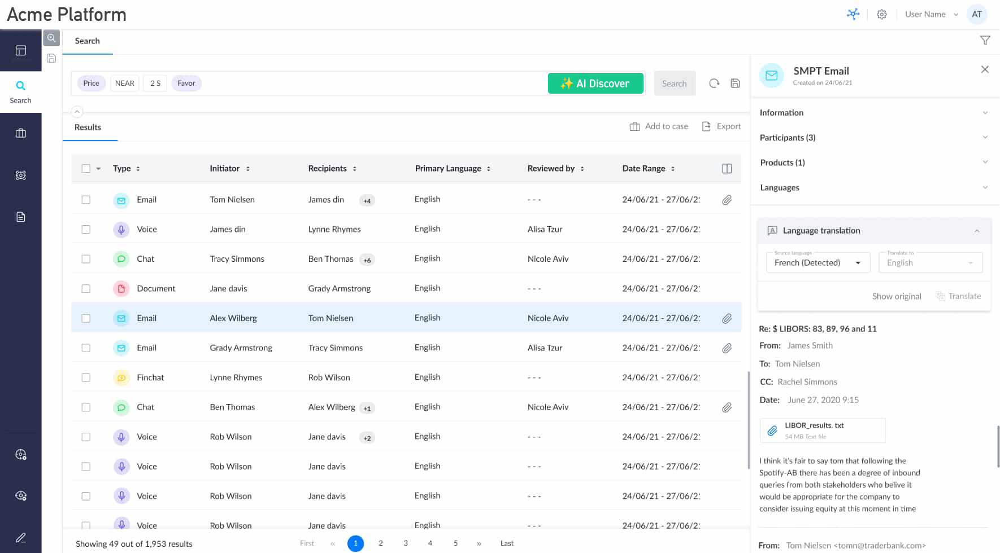
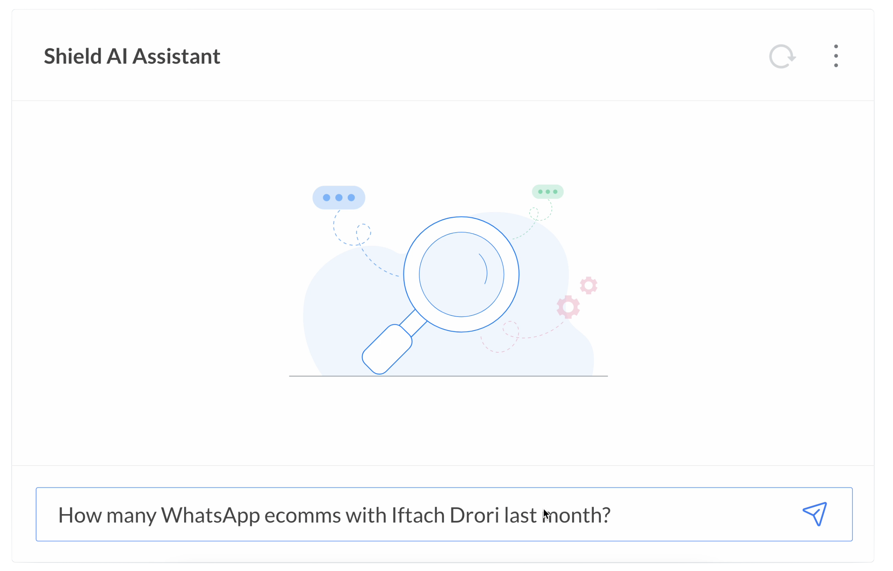
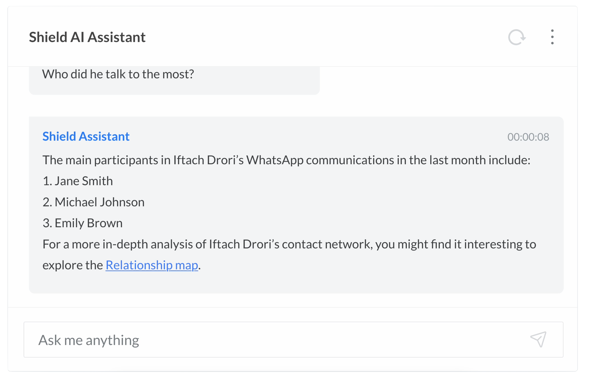
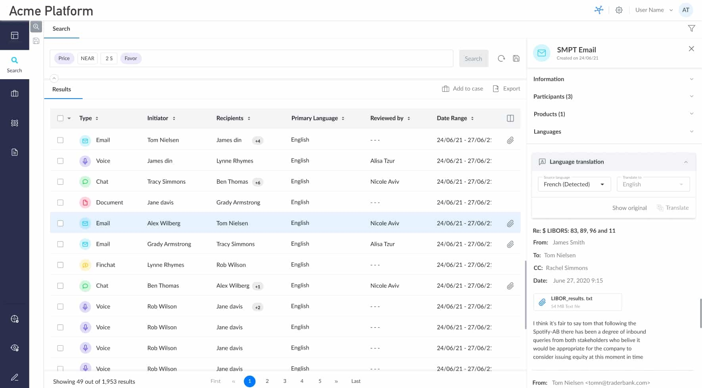

<span class="cs-page-kicker">Case studies > Acme (2024) > Knowledge base article</span>

# Find your risk data with Acme Discover

Acme **Discover** gives you fast search across your risk and compliance data. Structured queries help you find, analyze, and act on non-compliance risks in your organization. With the new generative AI assistant, you can also search your data in plain conversation.

!!! idea "Choose a topic below to learn more about Acme Discover."


/// caption
Acme Discover platform overview
///

## ✨ Acme AI Assistant

**Acme AI Assistant** lets you query your data in free, conversational language. It simplifies search and gets you to the data you need, however complex the query.

### Before you begin

Acme AI Assistant is available on the **Enterprise Plan** only. To compare plans, see [Acme pricing](https://link-to.pricing).

### Ask the assistant

1. In the Acme platform, go to the **Home** page.
2. Under the **Conduct** tab, go to the new **Acme AI Assistant** module at the right of the dashboard.
3. Enter your question or request.

### Check the result

The assistant responds in conversational English and sometimes suggests next steps to narrow your search. Give it feedback, or refine your prompt for a more precise search.

!!! example "The assistant works best with natural-language prompts."
    Write as you would in a conversation. For example:

    - *Show me my most critical non-compliance risks.*
    - *Show instances of market abuse in the organization from 2020 to 2022.*
    - *Can you find my new high-alert hits?*


/// caption
Ask the new Acme AI Assistant a question in natural, conversational English.
///


/// caption
The assistant provides actionable responses to help follow up on your request.
///

## Classic query-based search

!!! abstract "[Placeholder for structured search query KB]"



## Search with Acme Discover

!!! abstract "[Placeholder for search KB]"
    To get started with Acme Discover search...

    ```
    /* Examples: */

    // Helps you find... 
    Price NEAR 2S 'Favor'

    // Another example
    Email CONTAINS 'acmecorporation.com'
    ```

## Documentation approach

### How users reach this guide

Users reach the guide through three channels:

- **In-app** – A widget trigger sits in context, such as next to the search bar or in the assistant UI. It shows users how to work with the interface and how to get the most from the feature.
- **Web** – The knowledge base subdomain on the Acme platform hosts the guide, such as `https://app.acme.com/help`.
- **In-platform release notes** – The release note announces the feature with a summary and links to this guide.

### Keeping the structure logical and easy to navigate

- **Short answer** – Rigorous writing, rewriting, reviewing, and more rewriting.
- **Long answer** – A content style guide that defines the Acme tone and voice. It also sets the rules for creating knowledge base content.

### Validating that the guide is searchable

Common SEO practices and well-applied search tags make the guide findable.

A second test is an AI assistant with access to the knowledge base. Check whether it can generate helpful user-facing answers from the content. Treat AI confusion or hallucination as a sign that the knowledge base language needs a review.

### Measuring the guide's effectiveness

Data-driven practices measure effectiveness best. One method compares adoption across two segments of beta users. One segment can open the knowledge base content in-app and on the web. The other segment cannot.

Usage data shows how much users engage with the guide. Common key performance indicators (KPIs) include:

- View count, number of active sessions
- Session duration, drop-off times, bounce rate
- User flow and drop-off steps (i.e., how far into the guide users go)
- Obsolescence (i.e., content age vs. traffic)
- Common search terms, search success rate (i.e., whether users who search for the topic successfully land on the guide)
