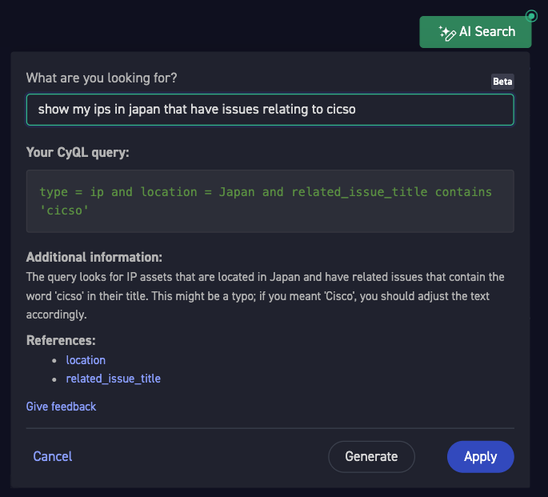

Case studies > AI Search (2024)

# AI Search (2024)

*A UX writing sample from CyCognito, a cybersecurity platform. AI Search turns a plain-language question into a query in the platform's own query language.*

| | |
|---|---|
| **My role** | Sole owner of UX microcopy. I wrote the copy, shaped the flow with PM and UX, and co-developed and owned the feature. |
| **Users** | Security teams searching their assets and issues |
| **Launch** | Beta in March 2024, with customer feedback in a private community channel |
| **Content in scope** | In-product copy, refusal messages, the system prompt, and the knowledge base articles it answers from |

## The problem

CyQL, the platform's query language, is powerful, but it has a learning curve. Customers struggled to find their data. Before AI Search, they read the documentation and tried on their own.

Three signals showed the size of the problem:

- **The field** – Colleagues were showing customers how to use CyQL in direct communication channels.
- **Customer Success and Support** – Customer feedback kept coming back through both teams.
- **Usage analysis** – The data showed how many failed queries customers made before they found what they wanted, or gave up.

AI could translate a question into a query, but that creates a new risk. A wrong query can look exactly like a right one. So the content had two jobs: make the feature easy to start, and make its answer easy to check.

## The screen

/// caption
The AI Search panel, with a plain-language question, the generated query, and an explanation of its logic
///

| Copy | Job | Why |
|---|---|---|
| "What are you looking for?" | Opens the conversation | It starts from what we knew about the user: they came here looking for something. |
| "Beta" | Sets expectations | It tells users that the feature is still improving. |
| "Your CyQL query:" | Shows the result | It shows the real query, so users can read it and start to learn the language. |
| "Additional information:" | Explains the logic | It restates the query in plain language, so users can check it without knowing CyQL. |
| "This might be a typo; if you meant 'Cisco', you should adjust the text accordingly." | Flags a likely mistake | It keeps the user's input and points out the problem. The user stays in control. |
| "References:" | Links to the documentation | Each property links to its article, so users can verify the query and learn more. |
| "Give feedback" | Collects signal | It gives users a low-effort way to report a bad answer during beta. |
| "Generate" and "Apply" | Separate the two steps | Users can review a generated query before they apply it. PM, UX, and I agreed on this flow early. |

**The label I argued for** – The first line users read could have been a direct "Enter your prompt". That describes what the system needs. I argued for "What are you looking for?", which addresses why the user is there. It did not take much arguing.

## When it cannot answer

A question the system cannot answer is a risky moment for trust. So the rule was to refuse, not guess.

AI Search refused in two cases:

- **Questions about the user's own data** – It could read only the CyQL documentation, with no access to user data.
- **Questions with no valid query** – No CyQL property or query could match the prompt.

The refusal itself followed three rules:

- **Answers come from the documentation** – If the documentation does not support a query, the assistant does not offer a plausible one.
- **Errors are short** – The message opens with a description of no more than four words.
- **Every refusal offers a way forward** – It suggests an alternative, and the whole response stays under 30 words.

## Launch and iteration

The work continued after launch, because real use showed what the first version missed.

- **Usage review** – I reviewed prompts and results, to find where answers failed and why.
- **Negative ratings** – I reviewed more than 110 negative ratings and turned them into 20 fixes, most of them shipped.
- **Test sets** – I graded test sets of 50 to 200 questions by hand. I then iterated on the prompts to cut wrong and hallucinated answers.
- **The field** – Colleagues knew what customers search for, and sometimes ran searches live with them. Their inputs mattered, and we reviewed each failure.

## What usage changed: nested queries

Usage review showed users starting to ask complex questions that needed nested CyQL queries. That launched a second level of the feature.

The answer started with the documentation. I documented the nested query syntax exhaustively, and wrote it for two readers: people and the model. I worked closely with the CTO on how to represent it.

## The result

The documentation set the starting point. Nested query benchmarking began well above what I had predicted. After that, polishing the knowledge base article and the prompt was easy.
