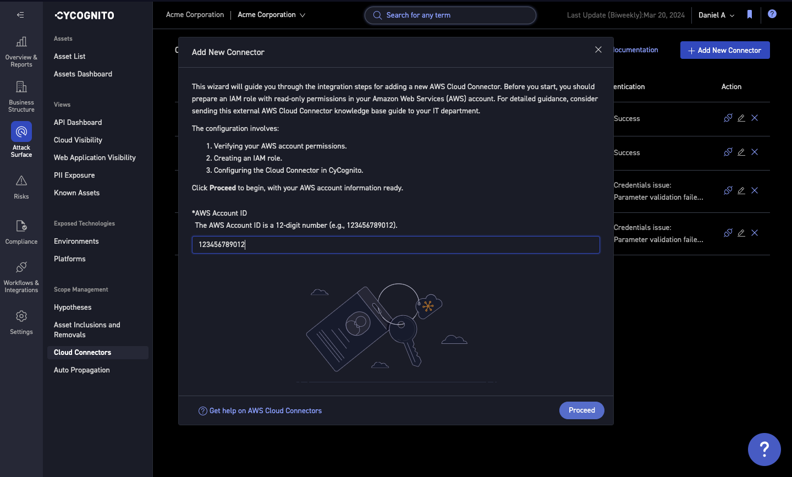

What I do

# UX Writing

Writing smart, helpful UX microcopy, focused on engaging and empowering users to adopt features more quickly.

For a full example from problem to launch, see the [AI Search case study](../case-studies/ai-search-2024/index.md).

/// caption
A setup wizard for adding a new cloud connector, with plain-language instructions and inline field help
///

